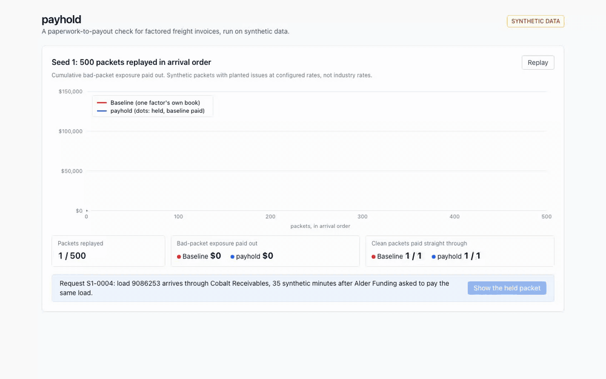

# payhold

By [Ahmed Sozzer](https://amsozzer.com) · [github.com/Amsozzer1](https://github.com/Amsozzer1)

A paperwork-to-payout check for factored freight invoices, run on synthetic data.

A factor asks to pay a carrier and attaches the load packet: the broker's rate confirmation, the signed bill of lading with proof of delivery, and the carrier's invoice. Factors defend against double factoring with notices of assignment, broker verification before funding and lien searches, and when it does get through it is often discovered after funding. A layer that sees requests from many factors can catch the same load at submission, before money moves. payhold reads the three PDFs, cross-checks them against each other and against what it has already seen (carriers on file, remit-to history, every load already requested or paid through any factor), and returns **pay** or **hold** with the exact reasons. It sends at most one linehaul payout per load, even under concurrent and repeated requests.



*Seed 1: 500 synthetic packets replayed in arrival order. The red line is planted-issue exposure the single-factor baseline paid out ($148,325 by the last packet); the blue line is payhold ($0). Both paid all 415 clean packets. Then the first double-factoring packet the baseline paid: load 9086253 arrives through a second factor 35 synthetic minutes after the first request, with boxes over the load and BOL numbers on all three documents and the reason line from the decision record.*

## Results

Measured on synthetic packets with planted issues, not real paperwork. Five report seeds (1-5), 500 packets each, generated with seeded randomness; thresholds were tuned on dev seeds 101-102 only, and the decision code was frozen before the report seeds were run. Issue rates are the generator's planting rates, not industry rates. Ranges are min-max across seeds.

| Scenario | Approach | Planted-issue exposure paid out, per seed | Clean packets paid straight through |
|---|---|---|---|
| Main stream, 5 seeds x 500 | **payhold** | $0 median ($0 to $0) | 100% of 1,775 plain clean; 100% of 300 seen look-alikes |
| | Baseline (one factor's own book) | $137,000 median ($133,500 to $148,325) | 100% of 1,775 plain clean; 100% of 300 seen look-alikes |
| Held-out look-alikes, 5 seeds x 50, written after the freeze | **payhold** | no planted issues in this set | 100% of 250 (125 DBA on the BOL, 125 same load number from a different broker) |
| | Baseline (one factor's own book) | no planted issues in this set | 100% of 250 |

Planted exposure per seed is $187,600 median ($181,750 to $195,650). The baseline holds every padded invoice and same-factor re-bill; what it pays out is the double-factoring, bank-change and double-brokering exposure. Detection by issue type is in [`results/numbers.md`](results/numbers.md); it is a coverage check (the same author wrote the generator and the checks), not an accuracy estimate.

| Measurement | Result | Runs | Where |
|---|---|---|---|
| Rail attempts per load, 50 concurrent distinct requests for one load, rail dedupe off | 1 in every trial | 100 trials | DynamoDB Local 3.3.1 in docker |
| Rail attempts per load, 50 concurrent copies of one request, rail dedupe off | 1 in every trial | 100 trials | DynamoDB Local 3.3.1 in docker |
| Crash after the rail call, retry after the lease expires | 2 attempts, 1 send in every trial | 100 trials | DynamoDB Local 3.3.1 in docker |
| Same as the first row with a read-then-write claim instead of the conditional write (control) | 5 to 37 attempts per load | 100 trials, one run; a race, so it varies | DynamoDB Local 3.3.1 in docker |
| Decision latency, extraction of 3 PDFs + checks, p50 / p95 | 16.81 ms / 20.24 ms (checks alone: 0.04 / 0.06 ms) | single run, n = 2,400 main-stream packets, one sequential process, first 100 dropped | MacBook Pro M4 (Mac16,1), in-memory store |

Every number above comes from a committed script with its raw output in [`results/`](results/): [`numbers.md`](results/numbers.md) says which are single runs and which are aggregates, and [`latency.md`](results/latency.md) has the timing setup.

## How it works

```
 factor request          ingest                 decide                        pay
 (3 PDFs, factor,  -->   extract fields   -->   run every check against  -->  conditional lease write on
  synthetic time)        (raw, norm, bbox)      seen_loads, registry and      paid_bills, call the rail
                         write seen_loads       remit-to history              once, mark sent by token
                                                hold -> reasons + audit log
```

- **Extraction.** pdfplumber words, anchored on labels. Two layouts per document type with different labels, column order, date and money formats; the layout is detected from the labels. Every field comes back as raw text, a normalized value, a bounding box and a page. Rules-based, on system-generated PDFs.
- **Keys.** `load_key = sha256(broker USDOT | broker load number)`, built only from rate con fields, so the same load printed as `4820157` or `482-0157` gets one key. The payout key is `load_key#linehaul`. A PRO number, when present, stays out of every key.
- **Checks**, one per issue type, each returning nothing or a reason with the fields behind it: invoice charges not on the rate con (padding); the same load or invoice number already paid or pending through the same factor (re-bill); the same load already requested through a different factor in any status (double factoring); remit-to not on file, or changed recently without verification from a contact on file (bank change); the carrier on the BOL is not the rate con carrier by USDOT or by name, legal name or DBA (double brokering).
- **Baseline.** What one factor's back office automates on day one: pay if the invoice total is at most the rate con total, the POD is signed, and neither the load nor the invoice number is already paid or pending in that factor's own book. It reads the same extracted packet as payhold and starts from the same pre-stream history.
- **Payout.** One conditional write takes a lease on the payout key (`attribute_not_exists(pk) OR (same request AND pending AND lease expired)`). Only the holder of the attempt token calls the rail; a loser reads the item with a consistent read and gets `duplicate` (another request) or `in_progress`/`sent` (its own retry). The rail is a fake that logs every attempt and dedupes on the key.
- **Handlers.** `ingest`, `decide` and `pay` are Lambda-shaped `handler(event, context)` functions over the same core. `seen_loads`, `paid_bills` and `audit_log` have DynamoDB key designs and run against DynamoDB Local; the eval uses an in-memory store with the same interface.
- **Eval.** `make eval` refuses to run the report seeds on a dirty tree or if `payhold/`, `config/`, `pyproject.toml` or `uv.lock` differ from the freeze commit in [`results/freeze.txt`](results/freeze.txt). The held-out look-alikes were specified before the build, opened only after the freeze, generated from a separate RNG, checked by a validator, and each decided against a snapshot of both deciders at the end of the main stream. Design decisions and what changed along the way are in [`docs/design-notes.md`](docs/design-notes.md).

## Run it

```sh
# requirements: uv 0.12+ (installs Python 3.12), Node 24, docker (colima works), ffmpeg (GIF only)
git clone https://github.com/Amsozzer1/payhold && cd payhold
make sync                 # git hooks + Python deps from uv.lock
make test                 # unit tests, extraction round-trip, determinism, held-out isolation
make test-integration     # starts DynamoDB Local in docker, payout trials (100 per scenario)
make gen SEED=1           # 500 synthetic packets, 1,500 PDFs, truth.json under data/seed-1
make eval                 # report seeds 1-5 -> results/numbers.md, latency.md, web data
make payout-trials        # duplicate-payout trials and the read-then-write control -> results/
make web                  # static page in web/out (serve it with any static server)
make gif                  # records docs/demo.gif with Playwright and ffmpeg
```

## Named assumptions

- Planting rates per 500-packet seed (`generator/settings.py`): padding 4%, duplicate re-bill 3%, double factoring 4%, bank change 3%, double brokering 3%, and three seen look-alike kinds at 4% each.
- One linehaul payout per load. Accessorials on the original invoice are part of that payout.
- A factor submits the rate con, BOL/POD and invoice together, as text PDFs.
- Brokers' load numbers are unique per broker, not globally, so the load key includes the broker's USDOT number.
- A remit-to change in the last 30 days is risky unless it was verified and requested from a contact on file.
- Pre-stream history (60 synthetic days of paid and rejected requests across four synthetic factors) is visible to payhold; the baseline sees only its own factor's paid history.

## Honest limits

- Everything is synthetic: carriers, brokers, factors, people, accounts and documents. Identifiers sit above the issued USDOT range, domains are `.example`, routing numbers start with `000`, and every page carries a SYNTHETIC watermark.
- The 100% detection rates are a coverage check. The same author wrote the generator and the checks, and designed the seen look-alikes before the freeze.
- The held-out DBA kind is weaker evidence than it looks. In 123 of 125 of those packets the BOL name differs from the rate con name; payhold passes them because its name check also accepts the DBA in the carrier registry. That rule was written before the freeze, but the plan already said carriers have DBAs.
- Extraction is rules-based on system-generated PDFs. It passed its round-trip (54,000 field checks on seed 1 and the dev seeds) on the first run, which shows the extractor matches the generator, not that it reads real paperwork. Phone-photo BOLs and OCR were not built.
- The carrier registry and remit-to history are fake local tables. There are no FMCSA lookups and no bank verification.
- Synthetic BOLs print the carrier's USDOT number. Real BOLs usually print the name and sometimes a SCAC code.
- DynamoDB Local, not AWS. The eval and the latency numbers use the in-memory store, so latency excludes store round-trips.
- The crash-after-send case relies on the rail deduping on the payout key: the retry makes a second attempt and the rail turns it into a no-op.
- Supplemental invoices on an already-paid load are held, not handled.
- The baseline has no NOA tracking, broker verification or lien search. Real factors use those, and they catch double factoring too, often later.

## What I'd do next

- NOA and letter-of-release checks.
- Phone-photo BOLs: an image-only BOL layout read with Tesseract, accuracy reported separately, an unreadable field becoming a hold with a reason.
- A fuzzy near-duplicate check (same lane, dates within a day, amount within 2%) as a hold, never an auto-reject.
- Supplemental accessorial payouts keyed per charge.
- A CDK app for the three handlers and tables.
- A review queue with release-with-note.

## License

MIT. Dependencies use permissive licenses (MIT and MIT-style, Apache-2.0, BSD, ISC, PSF; `caniuse-lite` data is CC-BY-4.0). The page uses Tailwind 3 because Tailwind 4's CSS engine is MPL-2.0, and `sharp` is replaced with an empty local stub because the static page never optimizes images and sharp's prebuilt libvips binaries are LGPL. Fetched at run time, not committed: the `amazon/dynamodb-local` docker image (AWS's DynamoDB Local license) and Playwright's Chromium build for recording the GIF.
